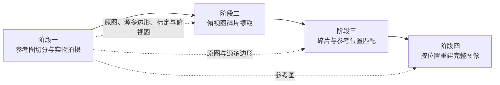

# 16 片几何拼图机器视觉重建

> 项目状态：四阶段工程骨架 + Stage 1 可执行实现 v0.4（2026-10-28）  
> 目标：把一张参考图按“递归两刀切分”得到 16 个直边凸多边形碎片，打印裁剪后散落拍摄，再经过相机标定、图像提取、特征匹配和最终拼接，恢复完整图像及每块碎片的位置。

> **当前切割方案（v0.3）**  
> 不再使用等大方格。先靠近画面中心选一个点，过该点画两条相交直线，把整张图分成 4 个凸区域；再在每个区域靠近中心处选一个点，过该点画两条相交直线，把该区域分成 4 块。四个区域递归后共得到 16 块。相邻一级区域的二级切线落在共同边界上的位置会被强制错开，避免接成一条连续直线。具体实现见 `shared/jigsaw_common/cut_layout.py`，打印文件生成见 `stage1_capture_calibration/make_print_pdf.py`。

## 1. 项目概述

本项目是一条由四个人依次交接的计算机视觉流水线。四个人不共享隐式状态，只通过明确的数据文件和 JSON 元数据交接。这样做的好处是每一阶段都可以独立开发、独立测试、独立替换算法。

整体流程：



| 阶段 | 负责人 | 输入 | 核心任务 | 输出 |
| --- | --- | --- | --- | --- |
| 1 | 采集与标定 | 原始参考图、打印纸、相机 | 递归两刀切成 16 个凸多边形、打印裁剪、散落拍摄、相机标定、俯视矫正 | 原图、16 个源多边形及参考掩码、标定参数、俯视整图、空白桌面俯视图 |
| 2 | 碎片提取 | 阶段一输出的俯视整图 | 分割 16 个凸多边形碎片、估计轮廓角点、透视归一化 | 每块扫描碎片的 RGBA 图、掩码、角点及质量元数据 |
| 3 | 特征匹配 | 原图/源多边形、阶段二碎片 | 特征提取、匹配、RANSAC、全局一一分配 | `扫描碎片 ID -> 源碎片 ID`、几何变换、置信度 |
| 4 | 拼接重建 | 碎片图、位置分配、参考图 | 按位置旋转对齐、颜色校正、融合接缝、质量评估 | 重建图、接缝图、质量报告 |

### 1.1 可行性结论

结论先说：**在受控拍摄条件下，这条流水线是可行的，且基线方案不需要训练任何深度学习模型。**

| 阶段 | 可行性 | 主要原因 | 最大风险 |
| --- | --- | --- | --- |
| 1. 切分、拍摄、标定、俯视矫正 | 高 | 递归两刀切分是确定性的，结果都是凸多边形；平面场景可用一张平放棋盘格求单应矩阵；RealSense 可直接用出厂内参 | 打印缩放错误、镜头畸变、反光、碎片互相接触 |
| 2. 碎片分割与归一化 | 中高 | 直边凸多边形轮廓规则，深色高对比桌面配合背景差分通常足够稳定 | 白色/浅色碎片的边缘、阴影、相邻碎片粘连 |
| 3. 特征映射到 16 个源位置 | 中 | 原图已知，SIFT + RANSAC + 全局分配是成熟方案 | 低纹理碎片、重复纹理、过曝或严重颜色偏差导致歧义 |
| 4. 按顺序拼接 | 高 | 位置离散且已知，只需旋转、缩放和融合 | 切边误差、亮度和颜色不一致、接缝明显 |

最关键的限制不是拼接算法，而是：

> **16 块碎片全部是直边凸多边形，没有拼图的凸凹边。单块碎片一旦离开原位，就只能靠正面印刷内容判断它属于哪一个源多边形。**

因此，参考图必须保证 16 个不规则子区域都包含足够纹理或可区分内容。大面积纯色天空、纯白背景、重复图案等会让某些碎片在理论上无法唯一识别，任何算法都无法可靠解决。

### 1.2 第一版范围

第一版建议严格限定为：

- 参考图可以是任意宽高比，第一版按递归两刀切分得到 16 个凸多边形。
- 16 块碎片正面朝上，不能翻到背面。
- 碎片之间至少留 5 至 10 mm 空隙，不重叠、不遮挡。
- 相机固定，焦距、曝光、白平衡固定。
- 拍摄平面与相机传感器基本平行，使用均匀漫反射光。
- 允许碎片在桌面平面内任意旋转；阶段二估计实际多边形角点，阶段三用单应/仿射变换恢复朝向。
- 16 个源多边形都包含足够多的可匹配特征。
- 第一版只做数字拼接；机械臂实物抓取与摆放在后续版本扩展。

以下情况不保证成功：

- 碎片翻面、破损、弯折、重叠或互相遮挡。
- 某个源多边形几乎纯色，或存在完全相同的重复图案。
- 强反光、严重阴影、镜头离焦、运动模糊。
- 不同阶段使用了不同画布比例或不同的裁切规则。

### 1.3 当前可执行实现

安装依赖并进入项目根目录：

```bash
python3 -m pip install -r requirements.txt
cd "/Users/tky/Desktop/作业/机器人视觉/jigsaw"
```

在当前机器上，系统 `/usr/bin/python3` 没有项目依赖；已安装依赖的解释器是
`/Users/tky/miniconda3/bin/python3`。如果没有先激活 conda 环境，请把下文的
`python3` 替换成该完整路径。

生成 16 块切分几何、参考资源、两页打印 PDF：

```bash
python3 stage1_capture_calibration/make_print_pdf.py \
  --image pic.jpg \
  --centre 0.52,0.48 \
  --stagger-ratio 0.10 \
  --gap-mm 3.0
```

主要输出：

| 路径 | 内容 |
| --- | --- |
| `stage1_capture_calibration/output/cut_pdf/jigsaw_16_pieces.pdf` | A4 横向、2 页；第 1 页为一比一裁剪页，第 2 页为编号与切分结构图 |
| `stage1_capture_calibration/output/cut_pdf/jigsaw_layout.json` | 16 个源多边形、中心点、切分角度和父子区域关系 |
| `stage1_capture_calibration/output/reference/reference.png` | 统一保存的原始参考图 |
| `stage1_capture_calibration/output/reference/source_pieces/` | 每块源碎片的 RGBA 和掩码 |

`--stagger-ratio` 控制二级切线在共同一级边界上的最小错开量，数值是“较短图边”的比例。默认 `0.10`；想错得更开可以增大到 `0.12-0.16`，想保留更多接近直角的多边形可以减小到 `0.07-0.09`。

运行几何测试：

```bash
python3 -m unittest discover -s tests -v
```

### 1.4 四人交接目录

工程按四个负责人拆成四个独立目录，Stage 2-4 只读取上一阶段落盘的 JSON 和图像，不依赖上一阶段进程内的变量：

```text
jigsaw/
├── pic.jpg
├── shared/jigsaw_common/              # 四阶段共用：几何、I/O、schema
├── stage1_capture_calibration/        # 切分、打印、拍摄、内参、棋盘格平面矫正
│   ├── config/
│   ├── input/
│   └── output/
├── stage2_piece_extraction/           # 背景差分、轮廓、碎片归一化
│   ├── config/
│   ├── input/
│   └── output/
├── stage3_feature_matching/           # SIFT/RANSAC/匈牙利分配
│   ├── config/
│   ├── input/
│   └── output/
├── stage4_assembly/                   # 回源坐标、融合、质量报告
│   ├── config/
│   ├── input/
│   └── output/
├── docs/
└── tests/
```

推荐的交接动作：

1. Stage 1 把 `jigsaw_layout.json`、`source_pieces/`、`intrinsics.json`、`rectification.json`、`pieces_rectified.png`、`empty_rectified.png` 复制到 Stage 2 的 `input/`。
2. Stage 2 输出 `pieces.json` 和 `pieces/S01_*.png`，复制到 Stage 3 的 `input/`。
3. Stage 3 输出 `assignments.json`，复制到 Stage 4 的 `input/`。
4. Stage 4 只依据 `assignments.json`、碎片图、源多边形和参考图生成最终结果。

每个交接 JSON 都带 `schema_version`，所有坐标方向固定为 `x` 向右、`y` 向下，长度单位优先使用毫米，画布坐标显式标注 `_px`。

## 2. 统一约定

为了让四个人可以独立交接，必须先固定以下约定。

### 2.1 编号与坐标

**源碎片编号 `source_piece_id`**

- 阶段一生成，编号为 `P01..P16`，表示原图中的 16 个源多边形。
- 一级四个区域先按中心点 `y`、再按 `x` 排序为 `R01..R04`。
- 每个区域内的四块再按中心点排序，依次得到 `P01..P04`、`P05..P08` 等。
- 该编号表示“这一块在原图中的身份”，不是扫描图里的检测顺序。

**扫描碎片编号 `scan_piece_id`**

- 阶段二在俯视图中检测到碎片后临时分配，建议为 `S01..S16`。
- 建议按碎片中心点 `y` 从小到大、再按 `x` 从小到大排序。
- 阶段三建立 `scan_piece_id -> source_piece_id` 的映射。
- 所有中间结果必须同时保留两个编号，不能只靠文件名猜语义。

**源区域与切分点**

- `R01..R04` 是一级四条边界形成的四个凸区域。
- 每个区域记录一个二级切分中心 `B-E`，以及两条二级切分线的角度。
- 每个源碎片记录其多边形顶点，后续参考掩码、匹配和拼接都以这些顶点为准。

**坐标系**

- 图像坐标：`x` 向右，`y` 向下，原点在左上角。
- 矫正后图像使用固定画布，例如 `2000 x 2000` 像素。
- 物理坐标：单位统一为毫米，原点在标定板/工作区左上角。
- 旋转角 `rotation_deg`：将碎片顺时针旋转多少度后与源坐标系对齐。递归切分的碎片不是规则方格，因此旋转角不限制为 90 度倍数。
- 所有单应矩阵统一命名为 `H_<源坐标系>_to_<目标坐标系>`，默认把源点映射到目标点。

**图像尺寸**

- 参考图保留原始宽高比；当前示例 `pic.jpg` 为 `1280 x 720`。
- 俯视矫正画布建议为 `2000 x 2000` 或 `2400 x 2400`。
- 每块扫描碎片归一化后的短边建议至少 `300-400 px`。

### 2.2 关键假设

| 假设 | 影响 | 不满足时 |
| --- | --- | --- |
| 碎片正面朝上 | 只能匹配正面印刷内容 | 翻面碎片需要背面编码或人工处理 |
| 碎片是直边凸多边形 | 可用多边形轮廓和角点做几何归一化 | 异形拼图需要边缘头/孔分类 |
| 碎片互不重叠 | 被遮挡区域无法恢复 | 需先人工分开，或用多视角重建 |
| 光照和相机固定 | 颜色、尺度、模糊程度保持一致 | 需要每张图重新估计颜色和几何参数 |
| 参考图每格有纹理 | 特征匹配可区分位置 | 增加水印、背面编号或改用其他素材 |
| 打印比例准确 | 实物尺寸和像素尺寸一致 | 标定后仍可工作，但打印与切割误差会增大 |

### 2.3 交接原则

- 每一步都必须可重复执行，不能依赖 Jupyter Notebook 中的手工变量。
- 每个输出目录必须包含一个版本化的 JSON 清单。
- JSON 必须包含 `schema_version`、`session_id`、图像尺寸、单位和算法版本。
- 任何需要人工干预的样本都要保留原始输入、失败原因和调参记录。
- 不用背面编号参与算法；背面编号只作为评测真值。

建议的交接目录：

```text
jigsaw/
├── README.md
├── requirements.txt
├── shared/
│   └── jigsaw_common/
│       ├── cut_layout.py
│       ├── io.py
│       └── schema.py
├── stage1_capture_calibration/
│   ├── config/
│   ├── input/{calibration,raw}/
│   ├── output/{cut_pdf,reference,calibration,rectified,calibration_targets}/
│   └── *.py
├── stage2_piece_extraction/
│   ├── config/
│   ├── input/
│   └── output/
├── stage3_feature_matching/
│   ├── config/
│   ├── input/
│   └── output/
├── stage4_assembly/
│   ├── config/
│   ├── input/
│   └── output/
├── docs/
└── tests/
```

## 3. 阶段一：参考图切分、实物拍摄、标定与俯视矫正

### 3.1 阶段目标

阶段一负责把“数字参考图”变成“可重复的实物实验”，并交付一张已经矫正为俯视图的碎片整图。

阶段一的输出必须回答三个问题：

1. 被打印的十六个区域分别对应原图的哪个位置？
2. 拍摄时的相机如何畸变，桌面平面如何映射到标准俯视画布？
3. 每个碎片在矫正图中大致在哪里，是否全部可见且互不接触？

### 3.2 参考图预处理

1. 读取原始图片。
2. 统一到 `sRGB` 色彩空间。
3. 保留原始宽高比，不做隐式正方形裁切。
4. 使用 `stage1_capture_calibration/make_print_pdf.py` 选择一级中心点，并自动搜索两级切分角度；二级切线在相邻一级区域共同边界上的落点默认至少错开较短图边的 `10%`。
5. 程序把整张图分成 16 个凸多边形，输出源碎片 `P01..P16` 的多边形顶点。
6. 为每个源多边形保存参考 RGBA、掩码、调试图和元数据：

```text
reference/
├── reference.png
├── source_pieces/
│   ├── P01_rgba.png
│   ├── P01_mask.png
│   ├── ...
│   └── P16_mask.png
└── jigsaw_layout.json
```

`jigsaw_layout.json` 至少需要记录：

```json
{
  "schema_version": "1.0",
  "source_size_px": [1280, 720],
  "seed": 20261028,
  "first_split": {
    "center_px": [665.6, 345.6],
    "angle_a_deg": 0,
    "angle_b_deg": 90
  },
  "regions": [],
  "pieces": [
    {
      "piece_id": "P01",
      "parent_region_id": "R01",
      "polygon_px": [],
      "centroid_px": []
    }
  ]
}
```

### 3.3 打印和裁剪

当前实现会把 16 块多边形**轻微分开排布到一页 A4 横向纸上**，每块之间保留约 `3 mm` 的可下刀空隙。这样不需要在碎片内部画贯穿图案的裁切线，直接沿每块图像的边缘裁剪即可。

建议参数：

- 纸张：`200-300 g/m²` 哑光纸，避免高光反射。
- 打印：A4 横向，关闭“适合页面”“自动缩放”，按 100% 实际尺寸打印。
- 颜色：尽量使用同一台打印机、同一套色彩配置；sRGB 素材不要被打印机自动增强。
- 裁切：使用金属直尺、切割垫和美工刀，沿每块碎片的洋红色边界裁切。
- 背标：在每块背面用铅笔写 `P01..P16`，仅用于评测和人工核对，**不能出现在正面算法输入中**。
- 打印校准：先量第 1 页底部的 `100 mm` 校准线；若长度不符，必须关闭自动缩放后重新打印。
- 装配核对：第 2 页提供 `P01..P16` 编号、一级切分点 `A` 和二级切分点 `B-E`，不要用第 2 页裁剪。

如果打印机无法无边距打印，应保留裁切余量。不要让白边留在最终碎片正面，否则白边会被误认为图像内容并污染特征匹配。

### 3.4 拍摄场景搭建

推荐使用固定俯拍支架：

- 工作区：`450 mm x 450 mm` 至 `500 mm x 500 mm` 的哑光深绿、深灰或黑色背景板。
- 主流程使用一张平放的 `9 x 6`、边长 `18 mm` 棋盘格估计桌面单应；ArUco 仅为可选路线。
- 棋盘格长边要与工作区 `x` 轴平行，外框左上角放在 `checkerboard_layout.json` 指定的位置。
- 相机光轴尽量垂直于桌面；可以使用水平仪或俯拍支架。
- 相机使用固定焦距、固定 ISO、固定快门、固定白平衡、手动对焦。
- 使用两盏 45 度方向的柔光箱或大面积漫反射光源，避免单一硬阴影。
- 在正式拍摄前先确认 16 块碎片都在视野内，并且互不接触。

分辨率建议：

- 相机原始拍摄不低于 `3000 x 3000`，优先 `4000 x 3000` 或更高。
- 矫正后每块碎片的短边至少占 `300 px`，推荐 `400-500 px`。
- 单块碎片像素太少会降低 SIFT 特征数量和角点精度。

### 3.5 必须拍摄的图片

阶段一至少拍摄以下三张图：

| 文件 | 内容 | 用途 |
| --- | --- | --- |
| `input/raw/plane.jpg` | 棋盘格平放在工作区 | 估计桌面到标准工作区的单应矩阵 |
| `input/raw/pieces.jpg` | 16 块碎片散落后的原始照片 | 保留原始证据 |
| `input/raw/empty.jpg` | 拿走棋盘格和碎片后的空桌面照片 | 背景差分和阴影建模 |

三张图必须保持相机、工作区和灯光完全不变。`empty.jpg` 对阶段二很重要：即使参考图中有白色、黑色或低对比度区域，空桌面背景图也能显著提高分割稳定性。

### 3.6 相机标定

相机标定分两层：

1. **内参和畸变标定**：解决镜头径向/切向畸变。
2. **平面单应矫正**：把桌面平面映射到固定俯视画布。

完整实物步骤见 `docs/camera_calibration.md`。代码入口分别是
`stage1_capture_calibration/calibrate_intrinsics.py` 和
`stage1_capture_calibration/rectify_capture.py`。

#### 3.6.1 获取相机内参

内参有两种来源，选一种即可。

**方式 A：Intel RealSense 出厂彩色内参。** 安装 `pyrealsense2` 后运行：

```bash
python3 -m pip install -r requirements-realsense.txt
python3 stage1_capture_calibration/export_realsense_intrinsics.py \
  --width 1280 --height 720 --fps 30
```

输出 `stage1_capture_calibration/output/calibration/intrinsics.json`。后续三张桌面图必须使用同样的彩色流分辨率。出厂内参通常足够本项目使用；Brown-Conrady 模型可直接交给 OpenCV，非零的 Inverse Brown-Conrady 等模型会明确报错并要求改用棋盘格标定或 SDK 去畸变。

**方式 B：棋盘格内参标定。** 先生成棋盘格，再按 `100%` 实际尺寸打印：

```bash
python3 stage1_capture_calibration/make_calibration_board.py
```

在正式拍摄相同的分辨率、焦距和自动对焦设置下拍摄 15 至 25 张不同姿态照片，覆盖画面中心和边缘。把照片放入 `stage1_capture_calibration/input/calibration/`，然后运行：

```bash
python3 stage1_capture_calibration/calibrate_intrinsics.py \
  --images stage1_capture_calibration/input/calibration \
  --cols 9 \
  --rows 6 \
  --square-mm 18
```

输出同一路径的 `intrinsics.json` 和 `undistorted_example.png`。检查 RMS 重投影误差，第一版目标可设为小于 `1.0 px`。如果相机或手机改变了分辨率、变焦倍率、对焦模式，必须重新标定；不能把一种分辨率的参数直接用于另一种分辨率。

#### 3.6.2 俯视单应矫正

桌面是平面，因此不需要做完整三维重建。主流程对一张平放棋盘格做去畸变，并用已知棋盘格尺寸和工件区坐标估计单应矩阵：

```text
棋盘格内角点 p_i  ->  标准俯视画布点 q_i
H = cv2.findHomography(p_i, q_i, cv2.RANSAC)
rectified = cv2.warpPerspective(
    undistorted,
    H,
    (canvas_width, canvas_height)
)
```

默认配置文件是 `stage1_capture_calibration/config/checkerboard_layout.json`：

```json
{
  "cols": 9,
  "rows": 6,
  "square_mm": 18,
  "workspace_mm": [400, 280],
  "canvas_px": [3200, 2240],
  "board_outer_origin_mm": [110, 77]
}
```

`board_outer_origin_mm` 是棋盘格最外层黑白方格外框左上角的毫米坐标。默认值把 `180 x 126 mm` 的棋盘格放在 `400 x 280 mm` 工作区中央。棋盘格长边必须与工作区 `x` 轴平行，不能旋转 90 度。普通棋盘格没有方向 ID，当前代码会按俯拍图像左上方向消除 180 度歧义。

固定相机后拍三张：

```text
stage1_capture_calibration/input/raw/plane.jpg    # 棋盘格平放在工作区
stage1_capture_calibration/input/raw/empty.jpg    # 拿走棋盘格和碎片
stage1_capture_calibration/input/raw/pieces.jpg   # 16 块碎片散落
```

运行矫正：

```bash
python3 stage1_capture_calibration/rectify_capture.py \
  --pieces stage1_capture_calibration/input/raw/pieces.jpg \
  --empty stage1_capture_calibration/input/raw/empty.jpg \
  --plane stage1_capture_calibration/input/raw/plane.jpg \
  --intrinsics stage1_capture_calibration/output/calibration/intrinsics.json \
  --checkerboard-layout stage1_capture_calibration/config/checkerboard_layout.json
```

最终输出：

```text
stage1_capture_calibration/output/rectified/
├── pieces_rectified.png
├── empty_rectified.png
├── rectification.json
└── checkerboard_detection_debug.png
```

如果棋盘格无法固定方向，旧 ArUco 路线仍可通过向 `rectify_capture.py` 传入 `--aruco-layout` 启用，但它不是默认依赖。

`rectification.json` 至少需要：

```json
{
  "schema_version": "1.0",
  "homography_raw_undistorted_to_rectified": [[1.0, 0.0, 0.0], [0.0, 1.0, 0.0], [0.0, 0.0, 1.0]],
  "inverse_homography": [[1.0, 0.0, 0.0], [0.0, 1.0, 0.0], [0.0, 0.0, 1.0]],
  "canvas_px": [3200, 2240],
  "workspace_mm": [400, 280],
  "rms_reprojection_px": 0.42,
  "camera_matrix": [[0.0, 0.0, 0.0], [0.0, 0.0, 0.0], [0.0, 0.0, 1.0]]
}
```

### 3.7 阶段一验收标准

- `reference.png`、`jigsaw_layout.json` 和 16 个源多边形完全一致，且面积总和等于原图面积。
- 打印尺寸测量误差小于 `1 mm`，或已在元数据中记录实际尺寸。
- `plane.jpg`、空桌面图与碎片图使用完全相同的相机状态；后两张图使用完全相同的矫正参数。
- 16 块碎片全部完整可见，没有重叠、遮挡和明显反光。
- 内参 RMS 重投影误差目标小于 `1.0 px`；棋盘格平面单应 RMS 目标小于 `2 px`。
- `rectified/pieces_rectified.png` 是稳定可复现的俯视画布，不依赖人工拖拽。

### 3.8 阶段一主要失败模式

| 失败模式 | 现象 | 处理 |
| --- | --- | --- |
| 打印被自动缩放 | 100 mm 校准线长度不符，碎片尺寸偏小 | 按 100% 实际尺寸打印，打印后先量校准线 |
| 镜头畸形 | 桌面直线弯曲，角点不准 | 内参标定后先 undistort 再求 H |
| 棋盘格不平或方向错误 | 单应后仍有透视误差或整体颠倒 | 把棋盘格粘平，长边对齐工作区 `x` 轴 |
| 反光 | 白块或局部高光 | 用哑光纸、偏振片或柔光箱 |
| 阴影过重 | 分割面积膨胀或边缘偏移 | 多方向柔光；用空桌面图做背景差分 |
| 碎片接触 | 两个轮廓连在一起 | 拍摄前确保间距；必要时分区域重拍 |

## 4. 阶段二：从俯视图中提取 16 块碎片

### 4.1 阶段目标

阶段二只接收阶段一的矫正图像，不依赖标定细节和相机内参。它的任务是把每块碎片从背景中分割出来，并将它变成一个适合特征匹配的标准化图像。

输入：

- `pieces_rectified.png`
- `empty_rectified.png`
- 可选的 `reference.json`

输出：

- 每块碎片的 RGBA 图；
- 每块碎片的二值掩码；
- 每块碎片在矫正图中的多边形角点；
- 碎片中心、面积、包围盒、质量分数；
- `pieces.json`。

### 4.2 推荐算法：背景差分 + 多边形轮廓 + 透视归一化

这是第一版最推荐的方案，因为它不依赖复杂模型，且递归两刀得到的碎片都是直边凸多边形。

#### 步骤 1：图像预处理

1. 将矫正图转换到 `Lab` 色彩空间。
2. 对空桌面图和碎片图分别做轻度高斯滤波。
3. 对两幅图的亮度做局部归一化，减少不均匀光照。
4. 计算像素差异：

```text
diff = || Lab(pieces_rectified) - Lab(empty_rectified) ||
```

5. 同时计算颜色差异和梯度差异，避免桌面阴影被误认为碎片。

#### 步骤 2：生成前景掩码

1. 对差异图做阈值分割，可以使用 Otsu 或自适应阈值。
2. 用开运算去掉小噪点。
3. 用闭运算填补印刷图案内部的孔洞。
4. 使用连通域分析，保留面积接近源多边形面积的候选区域。
5. 对每个候选区域检查：

   - 面积是否在合理范围内；
   - 轮廓凸度和实心度是否足够；
   - 角点数量是否在合理范围内；
   - 是否靠近工作区边界；
   - 是否与其他候选区域重叠或接触。

6. 如果碎片的打印内容与桌面颜色偶然接近，可以联合使用边缘图、色差图和背景模型。

#### 步骤 3：得到多边形角点

推荐优先级：

1. 对轮廓做 `cv2.approxPolyDP`，得到简化后的凸多边形。
2. 用凸包修正轻微凹陷或毛刺，但不能把真实轮廓角点抹掉。
3. 用相邻边缘直线拟合求交点，得到亚像素级角点。
4. 如果某条边被阴影污染，可以只使用置信度较高的一侧边缘。

角点必须按逆时针或顺时针固定排序，并记录起始角点规则。不同碎片的角点数量可以不同，一般为 3 至 6 个。

#### 步骤 4：透视归一化

对每块碎片做：

```text
src  = 检测到的多边形角点
dst  = 将多边形放进局部坐标系后的目标角点
M    = cv2.getPerspectiveTransform(src, dst)
piece = cv2.warpPerspective(image, M, output_size)
mask  = cv2.warpPerspective(foreground_mask, M, output_size)
```

输出可以是紧贴多边形的局部画布，也可以放进带透明边距的 `512 x 512` 画布。关键是要同时保存多边形在局部画布中的坐标。

这一步会消掉桌面平面内的旋转和轻微透视，但不会判断碎片属于原图哪个位置。位置和最终朝向由阶段三根据参考图确定。

#### 步骤 5：保存中间结果

建议每个碎片保存四个文件：

```text
pieces/
├── S01_rgba.png
├── S01_mask.png
├── S01_debug.png
├── S02_rgba.png
├── ...
└── pieces.json
```

`pieces.json` 示例：

```json
{
  "schema_version": "1.0",
  "coordinate_system": "rectified_px",
  "piece_size_px": [512, 512],
  "pieces": [
    {
      "piece_id": "S01",
      "rgba_path": "pieces/S01_rgba.png",
      "mask_path": "pieces/S01_mask.png",
      "corners_px": [[312, 420], [510, 416], [514, 612], [316, 616]],
      "center_px": [413.0, 516.0],
      "area_px": 38800,
      "quality": 0.96
    }
  ]
}
```

### 4.3 分割算法的备选方案

#### 方案 A：固定颜色阈值

适用于背景颜色稳定、碎片与桌面颜色差异明显的情况。

- 速度快，易调参。
- 对阴影、反光、与背景同色的碎片不稳健。
- 只建议作为辅助证据，不建议单独作为唯一分割方法。

#### 方案 B：空白桌面背景差分

第一版首选。

- 对白色、黑色、彩色碎片都可以工作。
- 需要保证相机、灯光和桌面不移动。
- 空桌面图必须与碎片图使用同一个相机状态。

#### 方案 C：SAM / MobileSAM 辅助分割

SAM 适合在背景复杂、碎片与桌面颜色接近时作为兜底方案。

- 可以给出高质量掩码。
- 需要提示点或自动生成候选区域。
- 模型体积和推理成本高于经典方法。
- 对直边凸多边形碎片，经典轮廓法通常更简单、更可控。

推荐策略：先做背景差分；如果某块碎片置信度低，再对局部区域调用 SAM 或 MobileSAM，而不是整条流水线默认依赖大模型。

### 4.4 阶段二验收标准

- 16 块碎片全部被检测到，无重复、无漏检。
- 每块碎片掩码与人工标注的 IoU 目标大于 `0.98`。
- 多边形角点误差目标小于 `2 px`。
- 归一化后的碎片方向稳定，角点顺序一致。
- 每块碎片都有质量分数，低于阈值时能被显式标记为需人工复核。
- 不把桌面阴影、标定板边缘、灰尘或碎片印刷内容误检成独立碎片。

### 4.5 阶段二主要失败模式

| 失败模式 | 原因 | 处理 |
| --- | --- | --- |
| 只检测到 15 块 | 两块粘连，或一块在画面外 | 拉开间距；使用分水岭或投影切分 |
| 一块碎片被拆成多块 | 碎片内部低对比区域被分割掉 | 闭运算、填充孔洞、凸包修正 |
| 白色碎片边缘丢失 | 白色印刷内容与浅色背景接近 | 深色哑光桌面、背景差分、边缘辅助 |
| 阴影被当成碎片 | 硬光导致大面积阴影 | 柔光、空桌面差分、Lab 色差而非只比较亮度 |
| 角点偏内 | 纸张边缘有白边或裁切毛刺 | 裁掉白边；用边缘拟合而不是只看轮廓极值 |
| 角点顺序不稳定 | 轮廓毛刺或边缘拟合不稳定 | 固定排序规则并记录；阶段三用匹配结果校验几何一致性 |

## 5. 阶段三：将扫描碎片映射到 16 个源多边形

### 5.1 阶段目标

阶段三使用参考图和阶段二输出的碎片，建立一一映射：

```text
scan_piece_id -> source_piece_id
```

同时输出每块扫描碎片到源坐标系的单应/仿射变换、匹配得分和置信度。

这是一个**有参考图的特征匹配问题**，不是无参考图的拼图求解问题。参考图已经告诉算法每个位置应该长什么样，因此比传统“只看边缘形状”的拼图求解容易得多。

### 5.2 源多边形模板的生成

阶段三不要重新猜测切分方式，必须直接读取阶段一保存的 `jigsaw_layout.json` 和 `source_pieces/`。

对每个源多边形建议保存：

- 原图多边形裁剪；
- 多边形掩码；
- 灰度图；
- CLAHE 增强图；
- 可选的特征掩码，避开 2 至 5 像素的外边界。

掩掉最外圈的原因：

- 切割边缘可能有白边、毛刺、阴影；
- 打印机可能在边界产生颜色偏差；
- 碎片边界特征对定位帮助不大，却容易产生重复匹配。

### 5.3 推荐主算法：SIFT + 比值检验 + RANSAC + 匈牙利分配

#### 步骤 1：特征提取

对每块标准化扫描碎片和每个源多边形模板提取 SIFT 特征：

- 灰度化；
- 可选 CLAHE；
- `cv2.SIFT_create()`；
- 计算关键点和 128 维描述子。

对于纹理较强的图像，SIFT 对亮度变化、尺度变化和平面内旋转都比较稳健，适合本项目的打印-拍摄差异。

#### 步骤 2：候选匹配

对每个扫描碎片 `i` 与每个源多边形模板 `j` 做特征匹配：

1. 使用 FLANN 或 BFMatcher 做 KNN 匹配，`k=2`。
2. 使用 Lowe ratio test，例如保留最近邻距离小于 `0.7 * 次近邻距离` 的匹配。
3. 至少保留若干组匹配点。
4. 使用 `cv2.findHomography(..., cv2.RANSAC)` 估计几何变换。
5. 统计 RANSAC 内点数、内点比例、重投影误差。

也可以先把碎片与整张 `reference.png` 做匹配，再根据单应矩阵判断它落在哪个源多边形内。两种方式的区别：

| 方法 | 优点 | 缺点 |
| --- | --- | --- |
| 碎片 vs 整张参考图 | 不会受多边形边界切割影响，定位直观 | 仍需判断源多边形身份，需处理跨边界特征 |
| 碎片 vs 每个源多边形模板 | 直接得到 16 个候选分数，方便匈牙利分配 | 边界附近特征被切断，可能降低分数 |

建议实现时两者都保留：整图匹配用于定位，多边形模板匹配用于构造代价矩阵和交叉验证。

#### 步骤 3：构造 16 x 16 代价矩阵

令 `score[i][j]` 表示扫描碎片 `i` 与源碎片 `Pj` 的匹配可信度。可以使用：

```text
score = w1 * 归一化内点数
      + w2 * 内点比例
      + w3 * 颜色相似度
      - w4 * 重投影误差
```

如果内点数太少、单应矩阵退化、估计出的尺度或位置不合理，则令该候选为不可用，赋予很大的代价。

必须检查单应矩阵的合理性：

- 行列式不能接近 0；
- 不能出现镜像翻转；
- 估计出的缩放比例应在合理范围内；
- 匹配中心不能落到工作区外；
- 碎片变换后的多边形应与源多边形大致重合；
- 变换后的中心应落在对应源多边形内部。

#### 步骤 4：全局一一分配

不能对每块碎片简单取 argmax，因为两个扫描碎片可能同时选中同一个源碎片。应使用匈牙利算法求全局最优一一分配：

```python
from scipy.optimize import linear_sum_assignment

row_ind, col_ind = linear_sum_assignment(cost_matrix)
```

这一步会强制每个扫描碎片对应唯一一个 `source_piece_id`，并且每个源碎片只被使用一次。对 16 块碎片来说计算量可以忽略。

#### 步骤 5：恢复几何变换和朝向

阶段二只消除了桌面拍摄造成的局部透视，不保证碎片相对原图的朝向。阶段三应使用匹配点直接估计单应矩阵 `H_piece_to_source`，并用它把碎片映射回原图坐标系。

同时可以分解出近似旋转角，作为可解释的辅助信息：

```text
rotation_deg = atan2(H[1, 0], H[0, 0])
```

同时检查：

- 行列式是否为正；
- 变换后的图像是否和源多边形在颜色、边缘和多边形形状上大体一致；
- 旋转角残差是否过大。

如果残差明显过大，说明单应估计或碎片角点可能有问题，应将候选标记为低置信度。

### 5.4 低纹理和重复纹理的处理

当某个源多边形几乎没有纹理时，SIFT 可能只有少量或零个关键点。此时可以按以下顺序降级：

1. **颜色和边缘描述子**：比较 Lab 均值、颜色直方图、边缘方向直方图、梯度幅值。
2. **整图颜色定位**：将碎片与整张参考图的局部窗口做归一化互相关或直方图匹配。
3. **深度特征匹配**：使用 LightGlue、LoFTR 或 Kornia 的特征匹配接口。
4. **人工复核**：显示前 3 个候选和置信度，由人工确认。

需要明确：如果两个源多边形在视觉上完全一样，算法无法仅凭正面内容区分它们。任何声称 100% 解决这种情况的方法，实际上都额外使用了位置、背面编号、厚度、放置顺序或其他先验信息。

### 5.5 阶段三输出

```json
{
  "schema_version": "1.0",
  "assignments": [
    {
      "scan_piece_id": "S01",
      "source_piece_id": "P07",
      "rotation_deg": 37.4,
      "homography_piece_to_source": [[1.0, 0.0, 0.0], [0.0, 1.0, 0.0], [0.0, 0.0, 1.0]],
      "confidence": 0.93,
      "inliers": 84,
      "inlier_ratio": 0.71,
      "median_reprojection_error_px": 1.8,
      "second_best_margin": 0.21,
      "status": "accepted"
    }
  ],
  "unassigned": [],
  "algorithm": "SIFT+RANSAC+Hungarian"
}
```

必须满足：

- `assignments` 中 `scan_piece_id` 唯一；
- `source_piece_id` 恰好覆盖 `P01..P16`；
- 每个低置信度结果显式标记为 `review`；
- 失败时不能悄悄输出一个看似完整的错误映射。

### 5.6 阶段三验收标准

- 在测试集上，16 块碎片的位置分配全部正确。
- 每块碎片的旋转方向正确，残差不超过约 `2-5` 度。
- 所有输出都是一一映射，不重复、不遗漏。
- 当最佳候选与次佳候选差距很小时，系统必须给出低置信度标记。
- 对有足够纹理的样本，SIFT 主方案应稳定；低纹理样本应能触发备用策略。

## 6. 阶段四：按顺序拼接完整图像

### 6.1 阶段目标

阶段四根据阶段三的 `scan_piece_id -> source_piece_id` 映射，把 16 块扫描碎片变换回各自的源多边形位置，恢复完整图像。

有两种最终形态：

1. **数字拼接**：输出一张 `assembled.png`。
2. **实物拼接**：输出每块碎片的目标多边形、变换和旋转角，由人或机械臂摆放。

### 6.2 数字拼接流程

#### 步骤 1：读取目标多边形

直接读取 `jigsaw_layout.json` 中 `P01..P16` 的 `polygon_px`，以原图尺寸创建空白画布：

```text
canvas = np.zeros((reference_height, reference_width, 3), dtype=np.uint8)
```

#### 步骤 2：将碎片变换到目标多边形

阶段三已经给出 `H_scan_to_source`。对每块扫描碎片：

1. 用 `H_scan_to_source` 把扫描碎片内容和掩码映射回原图坐标系；
2. 用目标源多边形 `Pxx` 的掩码限制有效区域；
3. 将结果粘贴到完整画布。

由于目标多边形已经在同一个原图坐标系中定义，所有碎片使用同一套绝对坐标，不会产生逐块累计误差。

#### 步骤 3：颜色校正

打印和拍摄会引入色偏。可以在 Lab 空间对每块碎片做轻量的均值/方差校正：

```text
piece_corrected = (piece - mean_piece) / std_piece * std_target + mean_target
```

目标统计量可以来自对应源多边形区域。注意：

- 颜色校正应保守，避免把真实纹理抹平；
- 如果参考图只作为“提示”，应同时输出未做颜色校正的版本；
- 颜色校正参数需要写入报告，便于复现。

#### 步骤 4：接缝融合

由于碎片是直边凸多边形，位置由多边形绝对坐标确定，第一版可以使用简单的 alpha 羽化：

1. 对碎片掩码做 1 至 3 像素腐蚀，避免纸张边缘；
2. 对边界做线性羽化；
3. 按源多边形逐块粘贴；
4. 对相邻接缝使用 feather blending 或 multi-band blending。

OpenCV 的 `cv2.detail_MultiBandBlender` 或 `cv2.detail_FeatherBlender` 可以作为高质量融合的参考。对于 16 块已经近似对齐的碎片，简单羽化通常就足够；如果存在明显曝光差异，再使用多频段融合。

#### 步骤 5：质量评估

输出至少包含：

- 与 `reference.png` 的 SSIM、PSNR；
- 每个接缝的平均颜色差和梯度差；
- 每块碎片的匹配置信度；
- 是否存在人工复核标记；
- 原图和重建图的并排对比图。

建议的初始目标是：

- 16 个位置全部正确；
- 视觉上无明显错位；
- SSIM 达到约 `0.85` 以上（受打印、拍摄和颜色差异影响，不宜把该阈值当成绝对标准）；
- 接缝区域没有明显断裂或色块跳变。

### 6.3 实物拼接扩展

如果最后由机械臂或人工按顺序摆放，阶段四输出一份明确的摆放计划：

```json
{
  "slot": [{
    "source_piece_id": "P13",
    "scan_piece_id": "S03",
    "target_polygon_px": [],
    "rotation_deg": 12.5,
    "homography_piece_to_source": []
  }],
  "coordinate_system": "reference_px"
}
```

如果是机器人执行，还需要补充：

- 像素坐标到工作台毫米坐标的映射；
- 工作台坐标到机器人基坐标的手眼标定；
- 碎片抓取点和放置点；
- 吸盘/夹爪尺寸、碎片厚度、避障和碰撞检测；
- 摆放顺序与堆叠策略。

这些属于机械臂集成层，不改变阶段一到阶段三的视觉数据契约。

## 7. 端到端可行性分析

### 7.1 为什么整体可行

这条流水线把一个困难的“无参考拼图求解”拆成了四个低耦合问题：

1. 几何切分是确定性的；
2. 平面相机矫正有成熟数学模型；
3. 直边凸多边形的分割比凸凹形拼图简单；
4. 有参考图时，特征匹配可以转化为位置检索和一一分配；
5. 拼接阶段只需要使用已经确定的离散坐标。

因此，第一版不需要训练神经网络。OpenCV 的相机标定、棋盘格单应、轮廓、SIFT、单应和透视变换已经覆盖大部分需求；ArUco 仅作为可选方向标记，深度模型只在低纹理、复杂背景或极端颜色变化时作为增强。

### 7.2 真正需要优先验证的风险

| 优先级 | 风险 | 验证方法 | 缓解方案 |
| --- | --- | --- | --- |
| P0 | 某些源多边形纯色，无法区分 | 对 16 个源多边形分别计算关键点数量和纹理指标 | 更换素材、增加纹理、接受人工复核 |
| P0 | 碎片粘连或互相遮挡 | 拍摄前检查；对掩码做连通域分析 | 加大间距；分区域重拍；分水岭 |
| P0 | 打印比例和裁切误差 | 量 100 mm 校准线；测量每块碎片尺寸 | 100% 打印；固定裁切夹具；标定实际尺寸 |
| P1 | 镜头畸变导致边缘弯曲 | 标定板直线检查 | 先 undistort 再单应 |
| P1 | 反光和阴影 | 多角度柔光照；空桌面图差分 | 哑光纸、偏振片、扩散板 |
| P1 | 颜色偏差导致匹配分数下降 | 比较 SIFT 和颜色特征分别的贡献 | 灰度特征为主，颜色为辅 |
| P2 | 接缝明显 | 查看放大接缝图和 SSIM | 羽化、多频段融合、保守颜色校正 |

### 7.3 建议的最小可行版本

第一版先不要追求“任意场景全自动”，而是把变量压到最少：

- 只做固定 seed 的递归两刀切分；
- 只用深色哑光背景；
- 碎片彼此分开、全部正面朝上；
- 相机固定、灯光固定；
- 16 个源多边形都有足够纹理；
- 使用 SIFT + RANSAC + 匈牙利算法；
- 对低置信度结果允许人工确认。

只要这个版本能在 20 组样本上稳定得到 16/16 的正确位置，再逐步增加旋转、反光、粘连和低纹理处理。

## 8. 推荐技术栈

### 8.1 基线依赖

| 组件 | 用途 |
| --- | --- |
| Python 3.11+ | 主开发语言 |
| NumPy | 矩阵和图像数组运算 |
| OpenCV (`opencv-contrib-python`) | 标定、棋盘格检测、轮廓、SIFT、单应、透视变换、融合；ArUco 为可选能力 |
| Shapely | 多边形切分、凸性检查、碎片分离和几何校验 |
| ReportLab | 生成可打印 PDF、矢量裁剪边界和校准尺 |
| Pillow | 生成源多边形 RGBA 和掩码资源 |
| SciPy | 匈牙利算法 `linear_sum_assignment` |
| scikit-image | 轮廓辅助、形态学、SSIM 等指标 |
| Pydantic | JSON 数据契约和校验 |
| Pytest | 单元测试和回归测试 |
| Typer / argparse | 命令行脚本 |

### 8.2 可选增强依赖

| 组件 | 适用场景 |
| --- | --- |
| LightGlue | SIFT 匹配失败时的深度局部特征匹配 |
| LoFTR | 低纹理、重复纹理的 detector-free 匹配 |
| Kornia | PyTorch 中的几何变换、匹配和可微分视觉工具 |
| SAM / MobileSAM | 复杂背景下需要提示式高质量分割 |
| AprilTag | ArUco 的替代标记方案 |

### 8.3 建议的代码结构

```text
jigsaw/
├── README.md
├── requirements.txt
├── shared/
│   └── jigsaw_common/
│       ├── cut_layout.py
│       ├── io.py
│       └── schema.py
├── stage1_capture_calibration/
│   ├── make_print_pdf.py
│   ├── make_calibration_board.py
│   ├── checkerboard_plane.py
│   ├── export_realsense_intrinsics.py
│   ├── make_aruco_markers.py
│   ├── calibration.py
│   ├── calibrate_intrinsics.py
│   ├── rectification.py
│   └── rectify_capture.py
├── stage2_piece_extraction/
│   └── extract_pieces.py
├── stage3_feature_matching/
│   └── match_pieces.py
├── stage4_assembly/
│   └── assemble.py
├── docs/
└── tests/
```

## 9. 开源项目调研

以下链接在方案编写时已核对仓库可访问。仓库的代码质量和许可证差异较大，**无明确 LICENSE 的项目只能作为思路参考，不要直接复制代码到要发布的项目中**。

### 9.1 基础视觉库

| 项目 | 许可 | 可复用内容 | 在本项目中的定位 |
| --- | --- | --- | --- |
| [OpenCV](https://github.com/opencv/opencv) | Apache-2.0 | 标定、SIFT、单应、透视变换、图像处理 | 主视觉库 |
| [opencv_contrib](https://github.com/opencv/opencv_contrib) | Apache-2.0 | ArUco 等扩展模块 | 标记检测与实验工具 |
| [scikit-image](https://github.com/scikit-image/scikit-image) | BSD 风格（以仓库为准） | 轮廓、形态学、图像质量指标 | OpenCV 的补充 |
| [Kornia](https://github.com/kornia/kornia) | Apache-2.0 | PyTorch 几何视觉、特征匹配接口 | 深度匹配实验 |
| [LightGlue](https://github.com/cvg/LightGlue) | Apache-2.0 | SuperPoint/DISK/ALIKED + LightGlue 匹配 | 低纹理匹配备用方案 |
| [LoFTR](https://github.com/zju3dv/LoFTR) | Apache-2.0 | Detector-free 局部特征匹配 | 弱纹理场景备用方案 |
| [Segment Anything](https://github.com/facebookresearch/segment-anything) | Apache-2.0 | 提示式分割 | 复杂背景分割兜底 |
| [MobileSAM](https://github.com/ChaoningZhang/MobileSAM) | Apache-2.0 | 轻量 SAM 推理 | 需要更低推理成本时 |
| [AprilTag](https://github.com/AprilRobotics/apriltag) | BSD 风格（以仓库为准） | 视觉基准标记 | ArUco 的替代方案 |

OpenCV 相关官方文档：

- [相机标定](https://docs.opencv.org/4.x/dc/dbb/tutorial_py_calibration.html)
- [ArUco 标记检测](https://docs.opencv.org/4.x/d5/dae/tutorial_aruco_detection.html)
- [特征匹配](https://docs.opencv.org/4.x/dc/dc3/tutorial_py_matcher.html)
- [单应矩阵](https://docs.opencv.org/4.x/d9/dab/tutorial_homography.html)
- [图像拼接](https://docs.opencv.org/4.x/d2/d2c/tutorial_stitcher.html)

### 9.2 可直接参考的拼图项目

| 项目 | 实现要点 | 对本项目的参考价值 | 限制 |
| --- | --- | --- | --- |
| [monzerelfeky/jigsaw-puzzle-cv-pipeline](https://github.com/monzerelfeky/jigsaw-puzzle-cv-pipeline) | 经典 CV、切片、边缘特征、匈牙利全局匹配 | 与阶段三的“16 个候选 + 全局分配”最接近 | 主要处理已切好的数字碎片，不覆盖实物拍摄和标定；仓库未声明许可证 |
| [chiaolun/jigsaw_helper](https://github.com/chiaolun/jigsaw_helper) | 相机拍摄单片、SIFT 与参考图匹配、旋转不变匹配 | 与阶段二/三的在线匹配思路接近，可参考接口和结果展示 | 单片提示系统，不处理 16 块同时散落；仓库未声明许可证 |
| [Alya0/Jigsaw-Puzzle-Solver](https://github.com/Alya0/Jigsaw-Puzzle-Solver) | 背景移除、轮廓、四角、SIFT 与 hint 图像匹配 | 阶段二轮廓提取 + 阶段三 hint 匹配的完整参考 | 面向传统拼图，假设和数据集与本项目不同；仓库未声明许可证 |
| [AbdulrhmanHammouda/JigsawPuzzleProject](https://github.com/AbdulrhmanHammouda/JigsawPuzzleProject) | 方形 2x2/4x4/8x8，经典边缘特征，4x4 报告约 92.73% | 可参考 4x4 的边缘描述、搜索和评测方式 | 其“拼图”是已网格化的数字切片，不是桌面实物；仓库未声明许可证 |
| [sherqo/jigsaw-puzzle-solver](https://github.com/sherqo/jigsaw-puzzle-solver) | 2x2/4x4/8x8、预处理、遗传算法求解 | 可参考传统全局搜索和评测脚本 | 与本项目的有参考图匹配路线不同；仓库未声明许可证 |
| [HamzaAlmahrous/jigsaw-genius](https://github.com/HamzaAlmahrous/jigsaw-genius) | 拼图与网格题求解项目集合 | 可用于了解不同求解器和前端展示 | 需要进一步核对其具体模块与许可证 |

### 9.3 选型建议

建议按以下优先级实现：

1. **阶段一**：RealSense 出厂内参或棋盘格内参 + 一张平放棋盘格求单应；ArUco 仅作可选方案。
2. **阶段二**：OpenCV 背景差分 + 凸多边形轮廓 + 角点拟合 + 透视归一化。
3. **阶段三**：SIFT + Lowe ratio test + RANSAC + SciPy 匈牙利算法。
4. **阶段四**：源多边形坐标变换 + 掩码羽化；必要时使用多频段融合。
5. **增强**：仅在 SIFT 失败时启用 LightGlue/LoFTR，仅在分割失败时局部启用 SAM/MobileSAM。

不建议第一版直接使用完整的深度拼图求解器，原因是：

- 本项目有参考图，问题不是无参考拼图；
- 16 块直边凸多边形的源位置只有 16 个候选，全局分配非常轻量；
- 经典方案更容易调试、解释和定位失败原因；
- 深度模型会增加训练/权重、显卡、推理时间和不确定性。

## 10. 评测方案

### 10.1 数据集

至少准备 20 张不同风格的参考图，每张至少 3 次拍摄，覆盖：

- 高纹理自然图像；
- 人脸、建筑、文字、重复图案；
- 大面积纯色或低纹理区域；
- 白色、黑色、彩色碎片；
- 不同旋转角和不同碎片间距；
- 正常光、偏色光、轻微阴影。

每张参考图的每个 `source_piece_id` 都应有人工真值。背面编号可以作为快速真值，但不能输入给算法。

### 10.2 分层指标

| 层级 | 指标 | 目标 |
| --- | --- | --- |
| 标定 | 重投影 RMS | `< 1.0 px` |
| 矫正 | 棋盘格单应 RMS | `< 2 px` |
| 分割 | 碎片检出率 | `16/16` |
| 分割 | 掩码 IoU | `> 0.98` |
| 匹配 | 位置准确率 | 测试集 `16/16` |
| 匹配 | 旋转准确率 | `16/16` |
| 全局 | 一一映射完整性 | 无重复、无遗漏 |
| 拼接 | SSIM | 约 `> 0.85`，以实际样本为准确立基线 |
| 拼接 | 接缝明显异常数 | 逐张人工检查 |

### 10.3 必须保留的失败样本

每次失败都至少保留：

- 原始拍摄图；
- 矫正图；
- 分割掩码；
- 检测到的角点；
- 匹配候选分数；
- 最终分配结果；
- 失败原因标签。

这些失败样本比“成功截图”更有价值，因为后续调参和增加备用算法都依赖它们。

## 11. 里程碑建议

| 里程碑 | 完成内容 | 验收方式 |
| --- | --- | --- |
| M0 | 固定编号、目录、JSON 契约和拍摄规范 | 四个人能按文档独立产出同样格式 |
| M1 | 参考图切分、打印、单应矫正 | 16 块可见，俯视图稳定 |
| M2 | 碎片分割和归一化 | 16/16 检出，掩码可复核 |
| M3 | SIFT 匹配和匈牙利分配 | 测试集位置全对 |
| M4 | 数字拼接和质量报告 | 视觉正确，指标可复现 |
| M5 | 低纹理、反光、粘连增强 | 失败样本有明确降级路径 |
| M6 | 可选机械臂实物拼接 | 像素坐标到机器人坐标闭环 |

## 12. 需要尽快确认的问题

1. 一级/二级切分点和角度是否固定，还是每次生成都重新随机采样？
2. 16 块碎片是否全部允许翻面和任意角度旋转？第一版建议只允许正面朝上。
3. 是否允许多拍几张、拼接多视角，还是必须一次拍摄全部碎片？
4. 最终交付是数字图像，还是要求机械臂真实抓取和摆放？
5. 是否允许在碎片正面加入定位标记？如果允许，会显著降低难度，但会影响最终图像。
6. 是否允许使用参考图进行颜色校正和接缝填充？这决定“重建”是否算使用 hint。
7. 评测数据能否保留背面编号作为真值，同时确保算法不读取背面？

在这些问题确认前，最稳妥的基线是：

> 任意宽高比参考图 + 固定 seed 的递归两刀切分 + 16 块直边凸多边形 + 全部正面朝上 + 互不接触 + 固定相机和灯光 + 深色哑光背景 + 一张平放棋盘格 + SIFT/RANSAC/匈牙利匹配 + 数字拼接。

这个版本技术风险最低，也最容易拆给四个人并行开发。

