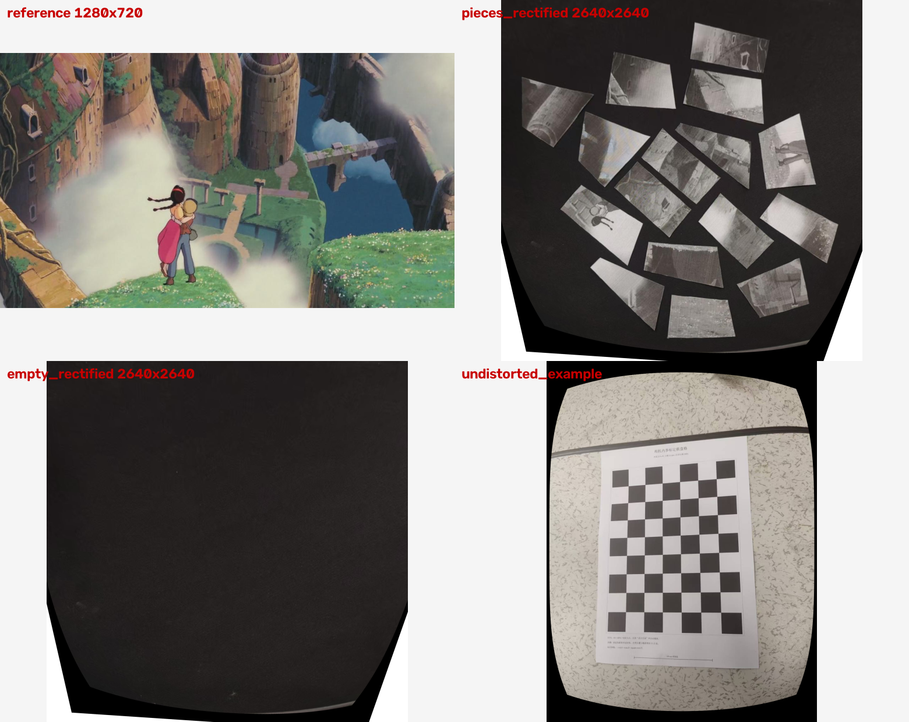

# 第一部分（Stage 1）复现记录

- 仓库：`https://github.com/walavave/jigsaw.git`，本地 HEAD `5871098`（"Add Stage 1 calibration captures, targets, and outputs"）
- 复现范围：**第一部分 = `stage1_capture_calibration`**（切分几何 → 打印 PDF → 参考资源 → 相机内参标定 → 俯视单应矫正）
- 复现结论：**全部四个脚本 + 测试套件可离线跑通，产物与仓库中提交的 Stage 1 结果数值/像素级一致**；56 项 Lead 侧校验全部通过，无失败、无告警。
- 不需要相机或实拍设备：仓库已提交全部拍摄输入（25 张标定图 + 桌面/碎片/棋盘格照片），因此 Stage 1 可以完全离线复现。



*左上是参考图 `reference.png`；右上是重新生成的 `pieces_rectified.png`（2640×2640 俯视画布，16 片照片碎片散落在黑色桌面上）；左下是 `empty_rectified.png`；右下是 `undistorted_example.png`（25 张标定图中取一张去畸变示例）。*

## 1. 环境

| 项目 | 值 |
| --- | --- |
| 操作系统 | Windows（工作目录含中文路径 `D:\University_documents\博一课程\机器人视觉（秋）\大作业`） |
| Python | 3.13.11（`C:\Users\86768\miniconda3\python.exe`） |
| 依赖安装 | `python -m pip install -r requirements.txt` |
| 实际装上的版本 | `opencv-contrib-python 5.0.0.93`（cv2 5.0.0）、`numpy 2.2.6`、`scipy 1.17.0`、`shapely 2.2.0`、`reportlab 5.1.0`、`Pillow 12.1.0` |

说明：

- 仓库的 `requirements.txt` 只约束 `opencv>=4.9`，不锁版本。本次用 OpenCV 5.0.0，而提交产物应该来自 OpenCV 4.x，这解释了后文“已知差异”里的大部分字节级差异。几何/数值结论不受影响。
- `pyrealsense2`（README 的内参“方式 A”）未安装，本次走**方式 B：棋盘格内参标定**，与提交产物使用的路线一致（`intrinsics.json` 中记录了 25 个标定视图）。
- OpenCV 对**非 ASCII 路径**的 `cv2.imread` 会直接失败。仓库自身代码用 `shared/jigsaw_common/io.py` 的“读字节 + `cv2.imdecode`”绕开了这个问题；本次的校验脚本 `docs/verify_stage1.py` 同样处理。在这个中文目录下自己写脚本时务必注意。

## 2. 复现命令

全部在仓库根目录 `D:\University_documents\博一课程\机器人视觉（秋）\大作业` 下执行。

### 2.1 切分几何 + 打印 PDF + 参考资源

```bash
python stage1_capture_calibration/make_print_pdf.py \
  --image pic.jpg \
  --centre 0.52,0.48 \
  --stagger-ratio 0.10 \
  --gap-mm 3.0
```

输出：`output/cut_pdf/jigsaw_16_pieces.pdf`、`output/cut_pdf/jigsaw_layout.json`、`output/reference/reference.png`、`output/reference/source_pieces/P01..P16_{rgba,mask}.png`。

### 2.2 测试

```bash
python -m unittest discover -s tests -v
```

结果：**12/12 通过**（4 个 `CutLayoutTests` + 8 个 `CalibrationTests`）。

### 2.3 棋盘格靶标 PDF

```bash
python stage1_capture_calibration/make_calibration_board.py
```

输出：`output/calibration_targets/checkerboard_6x8_25mm.pdf`（6×8 内角点，25 mm 方格，1 页）。

### 2.4 相机内参标定

```bash
python stage1_capture_calibration/calibrate_intrinsics.py \
  --images stage1_capture_calibration/input/calibration \
  --cols 6 \
  --rows 8 \
  --square-mm 25
```

输出：`output/calibration/intrinsics.json`、`output/calibration/undistorted_example.png`。

### 2.5 俯视单应矫正

README 里的文件名是通用的 `pieces.jpg / empty.jpg / plane.jpg`；仓库实际提交的是分轮次拍摄的 `pieces1..3.jpg / plane1..3.jpg`。提交的 `rectification.json` 记录使用的是 `pieces1.jpg + empty.jpg + plane3.jpg`，本次复现沿用同一组：

```bash
python stage1_capture_calibration/rectify_capture.py \
  --pieces stage1_capture_calibration/input/raw/pieces1.jpg \
  --empty stage1_capture_calibration/input/raw/empty.jpg \
  --plane stage1_capture_calibration/input/raw/plane3.jpg \
  --intrinsics stage1_capture_calibration/output/calibration/intrinsics.json \
  --checkerboard-layout stage1_capture_calibration/config/checkerboard_layout.json
```

输出：`output/rectified/{pieces_rectified.png, empty_rectified.png, checkerboard_detection_debug.png, rectification.json}`（画布 2640×2640）。

### 2.6 一键校验

```bash
# 先把“提交版”产物导出成基线，再和重新生成的结果逐项比对
git archive --format=tar -o tmp/baseline.tar HEAD stage1_capture_calibration/output
tar -xf tmp/baseline.tar -C tmp/baseline_extract
python docs/verify_stage1.py tmp/baseline_extract/stage1_capture_calibration/output
```

结果：`SUMMARY: 56 checks, 0 FAIL, 0 WARN`。

## 3. 复现结果（重新生成 vs 仓库提交版）

### 3.1 切分几何与打印 PDF

| 指标 | 结果 |
| --- | --- |
| 碎片数 / 区域数 | 16 / 4（P01..P16，父区域 R01..R04） |
| `jigsaw_layout.json` 多边形坐标 | **最大绝对偏差 0.000 px**（全部 16 片顶点逐一比较）；归一化换行后与 HEAD 提交内容**逐字节一致** |
| 面积守恒（Σ碎片面积 / 图像面积） | 1.000000001 |
| `reference.png` | **逐像素一致**（1280×720 RGBA，平均绝对差 0.0000） |
| 32 个源碎片 PNG | 30 个逐像素一致；仅 `P06_mask.png` / `P06_rgba.png` 在 98,571 像素中有 **1 个像素**不同（x=2, y=297），属 Pillow 12.1.0 光栅化边界打平规则差异，几何完全相同 |
| 打印 PDF | 2 页 A4 横向（297×210 mm），内容一致（忽略 `/CreationDate`、`/ModDate`、`/ID` 后）。参数回显：Pieces 16、Boundary stagger 82.1 px、Scale 0.197315 mm/px、Base 252.6×142.1 mm |
| 可重复性 | 同一命令连续两次运行，PDF/PNG 字节完全一致（确定性） |

### 3.2 相机内参

| 指标 | 提交版 | 重新生成 |
| --- | --- | --- |
| 接受视图 | 25 | 25/25 全部检出 |
| RMS 重投影误差 | 0.712849 px | **0.712608 px** |
| fx | 1320.8022 | 1320.8292（+0.027，+0.002%） |
| fy | 1318.4666 | 1318.4955 |
| cx / cy | 637.7776 / 854.1353 | 637.7613 / 854.1418 |
| 畸变系数 | [0.45747, -2.99753, -5.1383e-4, -4.5121e-4, 6.06925] | [0.45738, -2.99689, -5.1374e-4, -4.5088e-4, 6.06725]，最大绝对偏差 2.0e-3 |
| EXIF 方向归一化 | 13.jpg / 18.jpg 旋转 90° | 一致 |
| 棋盘格 PDF | 3311 B | 3222 B（内容流与 MediaBox 逐字节一致，仅 `/CreationDate` 不同） |

### 3.3 俯视矫正与画布

| 指标 | 提交版 | 重新生成 |
| --- | --- | --- |
| 方法 | checkerboard_plane | 同 |
| 输入 | pieces1 / empty / plane3 | 同 |
| 单应 RMS | 1.528916 px | **1.556909 px**（两者均 < 2 px） |
| 画布 | 2640×2640 | 2640×2640 |
| 棋盘格角点检测 | — | 与提交版最大偏差 **0.083 px** |
| 单应映射一致性（48 个棋盘格角点 → 画布） | — | 平均 **0.2086 px**，最大 **0.6185 px** |
| `pieces_rectified.png` | — | 平均绝对差 **0.606/255**（亚像素边缘重采样差异，OpenCV 5 vs 4） |
| `empty_rectified.png` | — | 平均绝对差 0.412/255 |
| `undistorted_example.png` | — | 平均绝对差 0.033/255 |
| `checkerboard_detection_debug.png` | — | 平均绝对差 0.040/255 |

单应矩阵原始条目本身的最大绝对差为 6.58（矩阵元素量级约 5×10³，条件数很差），但换成可解释的几何量纲后，48 个棋盘格角点映射到画布的平均误差仅 0.21 px、最大 0.62 px，说明这不是几何漂移，而是等价参数化的数值差异。

## 4. 已知差异与原因

1. **OpenCV 版本差异（主因）**：提交产物来自 OpenCV 4.x，本次是 5.0.0。内参拟合约 1e-5 量级、单应约 1e-6 量级、重采样图像亚像素级差异。
2. **PDF 元数据**：ReportLab 写入 `/CreationDate`、`/ModDate`、文件 `/ID`，每次生成不同；正文内容流一致。
3. **`P06` 的 1 个像素**：Pillow 12.1.0 的 `ImageDraw.polygon` 在边界打平时的取舍变化，只影响 1 个像素。
4. **JSON 路径分隔符**：`intrinsics.json` 的 `orientation_normalization` 键在 Windows 上写成 `stage1_capture_calibration\input\calibration\13.jpg`，提交版是 `/`。语义相同，仅字符串差异。
5. **换行符**：工作区文件经 `core.autocrlf` 转成 CRLF，提交库内是 LF；`git diff` 因此会显示整文件“改动”。

## 5. 环境坑（非仓库问题）

1. **`tests` 包名冲突**：本机 `ultralytics 8.3.252` 在 `site-packages` 里装了一个**普通包** `tests\__init__.py`，它会遮蔽仓库里没有 `__init__.py` 的命名空间式 `tests/` 目录。因此
   `python -m unittest tests.test_stage1_calibration -v`
   会报 `ModuleNotFoundError: No module named 'tests.test_stage1_calibration'`。README 里写的 `python -m unittest discover -s tests -v` 不受影响（12/12 通过）。等价可用写法：

   ```bash
   python -m unittest discover -s tests -p "test_stage1_calibration.py" -v   # 8/8
   cd tests && python -m unittest test_stage1_calibration -v                 # 8/8
   ```

   彻底修法（未实施，避免改动仓库源码）二选一：仓库 `tests/` 加一个空的 `tests/__init__.py`；或卸载/重命名 ultralytics 带的 `tests` 包。
2. **中文路径 + `cv2.imread`**：在含中文的绝对路径下 `cv2.imread` 返回 `None`。用
   `cv2.imdecode(np.fromfile(path, dtype=np.uint8), cv2.IMREAD_UNCHANGED)` 读取、`cv2.imencode(...)[1].tofile(path)` 写回。

## 6. 当前 git 工作区状态

重新生成覆盖了 15 个被跟踪的产物文件（0 新增、0 删除、`jigsaw_layout.json` 未变），这是“确实跑成功了”的直接证据，因此**保留在工作区、未提交**。如需恢复成提交版：

```bash
git checkout -- stage1_capture_calibration/output
```

本次新增（未跟踪）的只有文档与校验脚本：

- `docs/REPRODUCTION.md`（本文件）
- `docs/verify_stage1.py`（56 项校验脚本，只读，不写任何文件）
- `docs/stage1_preview.png`（四联预览图）

`tmp/` 下的基线快照、日志、临时脚本已被 `.gitignore` 忽略。

## 7. 第二部分（Stage 2）

第二部分已完成，实现与验证报告见 **`docs/REPRODUCTION_STAGE2.md`**（产物：`stage2_piece_extraction/output/pieces.json`、`pieces_base_edge.json` + 16×3 张基边 1:1 裁剪图，16/16 检出、确定性可复现、`python -m unittest discover -s tests -v` 67 项全绿）。
