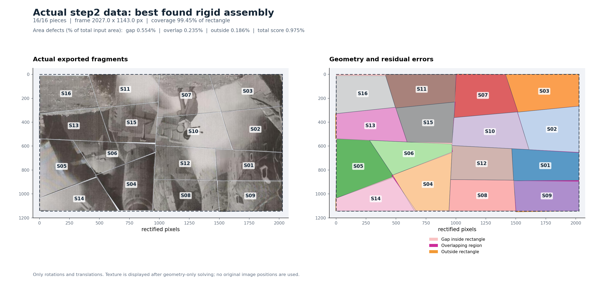

# 凸多边形拼接

`jigsaw.py`（v3.0.1）根据碎片局部几何求解矩形布局，只做旋转和平移。默认允许测量误差，返回搜索中保留的最佳完整布局及误差指标。随包只有主程序、本说明，以及 `examples/` 中的实际输入、输出和效果图。

## 1. 安装与调用

Python 3.11+，在工程目录运行：

```bash
python -m pip install numpy==2.3.5 shapely==2.2.0 scipy==1.17.0
python jigsaw.py solve examples/input.json --time-limit 180 --seed 0 -o result.json
python jigsaw.py evaluate examples/input.json result.json
```

| 命令 | 作用 |
|---|---|
| `solve INPUT -o OUTPUT` | 默认近似求解，返回完整布局 |
| `solve INPUT --mode exact -o OUTPUT` | 严格求解，要求通过几何容差检查 |
| `evaluate INPUT RESULT -o REPORT` | 根据位姿重算质量指标，不设误差门槛 |
| `verify INPUT RESULT -o REPORT` | 根据位姿执行严格验收 |
| `validate INPUT -o REPORT` | 检查输入格式及片形 |
| `normalize INPUT -o OUTPUT` | 转为统一凸多边形格式，保持坐标和比例 |
| `--help`、`solve --help`、`--version` | 总帮助、子命令帮助、版本；各子命令均支持 `--help` |

以上命令均加前缀 `python jigsaw.py`。参数说明：

| 参数 | 默认值与含义 |
|---|---|
| `-o` / `--output` | 输出文件；省略或设为 `-` 时写标准输出 |
| `solve --time-limit` | `30` 秒搜索预算；默认模式允许 `0`，仍生成完整初始布局；严格模式须大于 `0` |
| `solve --mode` | `best-effort`，可选 `exact` |
| `solve --seed` | `0`，非负整数；控制默认模式的随机搜索 |
| `solve --max-boundary-edges` | `4`，仅严格模式使用；单条外框边候选最多由几条片边相加，范围 `1–8` |
| `verify --rtol` | `1e-7`，严格验收相对容差，须在 `0` 与 `1` 之间 |

输入路径 `-` 表示标准输入，例如 `python jigsaw.py solve - < examples/input.json > result.json`。`verify/evaluate` 的两个输入不能同时为 `-`；输出路径不能覆盖输入。读取、初始布局及最终评估会产生搜索预算之外的少量耗时。

## 2. 输入格式

### 项目实际 JSON

`examples/input.json` 是 GitHub [`step2` 固定提交中的 pieces_base_edge.json](https://github.com/walavave/jigsaw/blob/64d689d4b1006407f4e7db03f289b910b75474a2/stage2_piece_extraction/output/pieces_base_edge.json)，含 16 块真实测量碎片，可直接输入。

| 字段 | 含义 |
|---|---|
| `schema_version`、`coordinate_system` | 分别为 `"1.0"`、`"rectified_px"`；输出单位沿用 `rectified_px` |
| `unit_scale`、`piece_count` | 比例须为 `1`；块数须等于 `pieces` 数组长度 |
| `pieces[].id/baseLength/p2/p3` | 碎片 ID、最长边、P2 和 P3 的局部坐标，定义见下文 |
| `algorithm_version`、`session_id` | 上游算法版本及批次标识 |
| `px_per_mm`、`base_edge` | 像素密度及基边文字说明；程序不自动换算单位 |

也支持完整版 `pieces.json`：几何取 `pieces[].base_edge`，要求 `piece_id == base_edge.id`；比例和块数取 `piece_scale`、`detected_piece_count`。图片、拍摄位置及 `canvas_px` 不参与求解。要指定外框，先 `normalize`，再添加 `target`。

### 统一凸多边形 JSON

```json
{
  "schema": "polygon-assembly/v1",
  "unit": "mm",
  "pieces": [
    {"id": "A", "baseLength": 5.0, "remainingVertices": [[5.0, 2.0], [0.0, 2.0]]}
  ]
}
```

| 字段 | 含义 |
|---|---|
| `schema` | `polygon-assembly/v1` |
| `unit` | 非空单位名称；所有碎片须同单位、同比例 |
| `pieces`、`id` | 非空碎片数组；每块 ID 为唯一、非空字符串 |
| `baseLength` | 正数，**该块最长边长度**；并列最长可任选一条 |
| `remainingVertices` | 从 P2 起顺序给出 `[x,y]`；n 边形提供 n−2 个点，不重复闭合点 |
| `target`（可选） | `{"width":1280,"height":720}`，宽高为正、与输入同单位；省略则估计外框 |

隐含 **P0=(0,0)、P1=(baseLength,0)**。坐标系 x 向右、y 向下；P0、P1、P2…顺时针排列，严格凸、无自交、重复顶点或共线冗余点，数值有限。可混合不同顶点数，局部 x 可以为负。

旧四边形格式也支持：`schema` 改为 `quad-assembly/v1`，每块用 `p2:[x,y]`、`p3:[x,y]` 替代 `remainingVertices`。这两种原生格式不接受未定义字段。

## 3. 输出格式

默认输出协议为 `polygon-assembly-result/v2`；严格模式为 `polygon-assembly-result/v1`，严格模式的旧四边形输入则对应 `quad-assembly-result/v1`。

| 字段 | 含义 |
|---|---|
| `schema`、`status` | 输出协议及状态 |
| `unit`、`coordinateSystem` | 与输入相同的单位；坐标系固定 `image` |
| `rectangle.width/height` | 矩形宽高，画布左上角为 `(0,0)` |
| `placements[].id` | 对应输入 ID，每块恰好一次 |
| `placements[].rotationDeg` | 绕输入 P0 **顺时针旋转角度**，范围 `[0,360)` |
| `placements[].origin` | 输入 P0 在画布中的最终 `[x,y]`，不是 PNG 左上角 |
| `quality` | 默认模式的质量指标；严格模式可用 `evaluate` 另算 |
| `verification` | 严格验收诊断；`valid=false` 不阻止返回近似布局 |
| `reason` | 原因；成功精确布局为 `null`，近似结果通常为 `best_found_within_budget` |
| `stats` | 搜索统计，见下文 |

局部点变换如下；近似布局可能有少量越界：

```text
theta = rotationDeg * pi / 180
x_canvas = origin[0] + x*cos(theta) - y*sin(theta)
y_canvas = origin[1] + x*sin(theta) + y*cos(theta)
```

| `status` | 含义 | `solve` 退出码 |
|---|---|---:|
| `feasible` | 完整布局通过严格容差检查 | 0 |
| `approximate` | 完整布局，保留残余误差 | 0 |
| `unknown` | 严格模式在预算内未找到合格布局 | 2 |
| `infeasible` | 严格模式发现必要条件矛盾 | 3 |
| `invalid_input` | 格式、片形或参数非法 | 4 |
| `error` | 依赖、读写或运行错误 | 5 |

仅在 `feasible/approximate` 时使用位姿。`validate/verify` 通过退出 `0`、未通过退出 `1`；`evaluate/normalize` 成功退出 `0`、输入非法退出 `4`；依赖或读写错误退出 `5`。随包近似结果执行严格 `verify` 返回 `1` 属于预期。

## 4. 输出指标

### `quality`

面积单位为输入单位的平方，距离单位与输入一致；比例均为小数，乘 100 才是百分数。下表记输入总面积为 A，矩形面积为 R。

| 字段 | 含义 |
|---|---|
| `pieceCount`、`totalPieceArea`、`rectangleArea` | 碎片数、A、R |
| `unionArea`、`coveredArea` | 碎片并集总面积（含越界）、矩形内覆盖面积 |
| `missingArea` | 空隙面积：R−coveredArea |
| `overlapExcessArea` | 重复覆盖的多余面积：A−unionArea |
| `outsideArea` | 碎片并集在矩形外的面积 |
| `pairwiseOverlapArea` | 所有不同碎片对的交集面积之和，辅助诊断 |
| `relativeMissingArea`、`relativeOverlapExcessArea`、`relativeOutsideArea`、`relativePairwiseOverlapArea` | 上述四类误差面积分别除以 A，越小越好 |
| `coverageFraction` | coveredArea/R，越接近 1 越好 |
| `score` | (missingArea+overlapExcessArea+outsideArea)/A，**选优指标，越小越好** |
| `maxOutsideDistance` | 全部顶点沿 x/y 的最大越界量：max(0,−x,x−width,−y,y−height)，越小越好 |
| `objective`、`normalization` | 评分公式与归一化说明；后者为 `total_input_piece_area` |

三重覆盖处，`overlapExcessArea` 计两份多余面积，`pairwiseOverlapArea` 计三对交集；评分使用前者。保存的最佳结果不代表已证明全局最优。

### `verification` 与输入检查

`valid/errors/tolerance` 分别为验收是否通过、失败原因、相对容差。`metrics` 的面积分母为 **B=max(A,R)**，与 `quality` 不同：

| 指标 | 定义 |
|---|---|
| `relativeAreaError` | abs(A−R)/B |
| `relativeOverlapArea` | 两两交集面积和/B |
| `relativeMissingArea`、`relativeOutsideArea` | 空隙面积/B、越界面积/B |
| `relativeSymmetricDifference` | (空隙面积+越界面积)/B |
| `relativeOutsideVertexDistance` | 最大单轴越界量/L；L=max(矩形宽高,全部输入局部坐标绝对值) |

上述误差须不超过容差，并满足结构、ID、目标尺寸等检查。`validate` 报告中的 `pieceCount/vertexCounts/totalArea` 是块数、各块顶点数、总面积；`valid/errors` 为输入检查结论，`errorCode`（如有）标识运行错误。

### `stats`

| 字段 | 含义 |
|---|---|
| `mode`、`seed` | 模式与随机种子 |
| `timeLimitSeconds`、`elapsedSeconds` | 搜索预算与实际总耗时，单位秒 |
| `bestPlacedCount`、`completeCandidateCount` | 最佳布局块数、初始化候选列表大小（不含每次连续微调） |
| `objectiveEvaluations`、`improvements` | 目标函数调用数、更优布局保留次数 |
| `optimalityProven` | 是否证明全局最优，当前为 `false` |
| `inputGeometryChanged`、`usedImageContent`、`usedOriginalPositions` | 是否修改片形、使用图像、使用原位置，当前均为 `false` |

严格模式另有 `searchSeconds/nodes/candidateTests`（搜索秒数、节点、候选检查数）、`frameCandidates/selectedFrameIndex`（外框候选数及所选下标）、`boundaryEnumerationComplete/candidateLimitApplied/candidateLimitReasons`（枚举完整性、截断及原因）、`rectangleCornerCheck`（矩形角必要条件诊断）。统计不用于衡量布局质量。

## 5. Python 调用

```python
from jigsaw import read_json, solve, write_json, normalize_input, apply_placement

puzzle = read_json("examples/input.json")
result = solve(puzzle, time_limit=180.0, mode="best_effort", seed=0)
write_json(result, "result.json")
if result["status"] in {"approximate", "feasible"}:
    poses = {p["id"]: p for p in result["placements"]}
    for piece in normalize_input(puzzle)["pieces"]:
        print(piece["id"], apply_placement(piece, poses[piece["id"]]))
```

其他入口：`validate_input(puzzle)`、`evaluate(puzzle,result)`、`verify(puzzle,result,rtol=1e-7)`；`solve(...,mode="exact",max_boundary_edges=4)` 或 `solve_exact(puzzle,time_limit=30,max_boundary_edges=4)` 进行严格求解。`normalize_input/evaluate/apply_placement` 遇到非法格式会抛出 `ProtocolError`；`read_json/write_json` 支持路径 `"-"`，后者默认写标准输出。

## 6. 保留的实际结果

`examples/output.json` 保留此前预算 180 秒、种子 0 的最佳布局：**16/16 块，2027.016623×1142.954974 rectified_px，覆盖率 99.446573%，综合误差 0.975249%**。空隙、重叠多计、越界分别占输入总面积的 `0.554164% / 0.235197% / 0.185889%`，最大单轴越界量为 `7.743741 rectified_px`。

复核指令：`python jigsaw.py evaluate examples/input.json examples/output.json`。重跑受时间预算、机器速度和种子影响，结果不保证逐字一致。



图中浅红为缝隙、洋红为重叠、橙色为越界；图像按保存的位姿绘制，仅用于展示。求解只需要主程序、依赖和输入 JSON。
