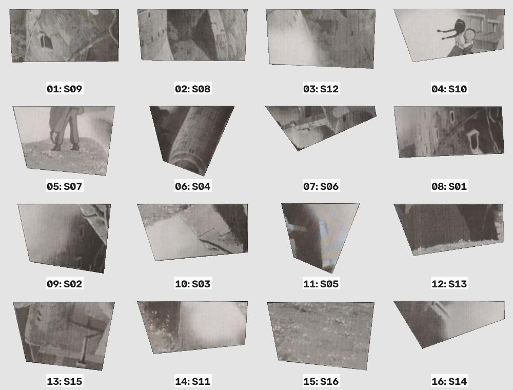
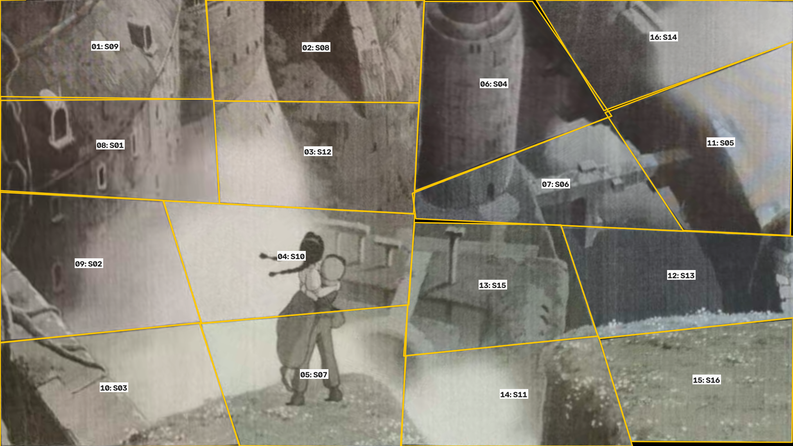
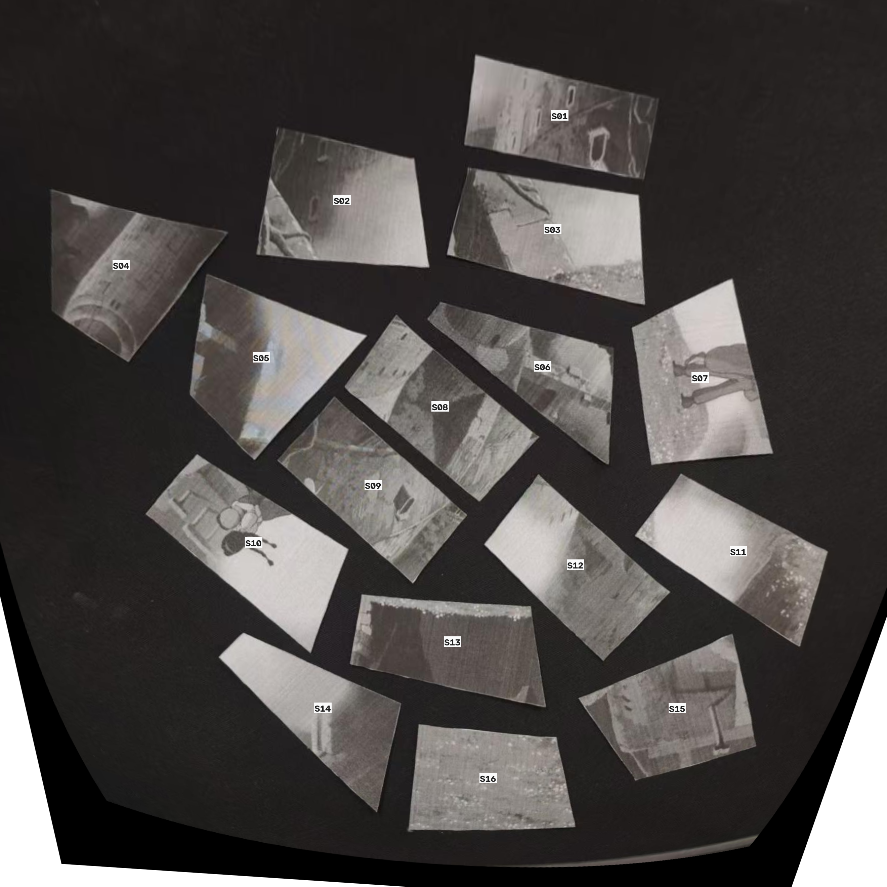

# 人工摆放计划

在空白区域建立目标外框：左上角为原点，x 向右、y 向下。按顺序图及下表逐片摆放。
目标外框的坐标轴与原俯视图坐标轴保持平行；若整体转动外框，表内转角还须叠加该转角。
旋转角以原始俯视照片中该片的朝向为起点；正值顺时针，负值逆时针。先核对取片图中的 S 编号。
原照片中的碎片若已被移动或转动，请重新核对朝向；PNG 的基边方向不是桌面原朝向。

目标外框约 253.38 × 142.87 mm；毫米坐标只表示该外框内的相对位置。

待复核事项：

- Stage 3 layout is approximate; gaps, overlaps and boundary errors remain.
- S06: upstream manual review required.

| 步骤 | 取片 | 从原桌面朝向旋转 | 目标中心 (px) | 对齐已放碎片 | 复核 |
| --- | --- | --- | --- | --- | --- |
| [1](steps/01.png) | S09 | 逆时针 42.56° | (268.4, 126.2) | 建立锚点 | — |
| [2](steps/02.png) | S08 | 逆时针 40.07° | (807.5, 128.9) | S09 | — |
| [3](steps/03.png) | S12 | 逆时针 41.15° | (812.2, 396.2) | S08 | — |
| [4](steps/04.png) | S10 | 顺时针 143.01° | (743.7, 664.0) | S12 | — |
| [5](steps/05.png) | S07 | 逆时针 81.93° | (801.9, 966.7) | S10 | — |
| [6](steps/06.png) | S04 | 顺时针 145.71° | (1261.6, 222.1) | S08, S12 | — |
| [7](steps/07.png) | S06 | 逆时针 36.20° | (1420.4, 479.2) | S04 | 需要 |
| [8](steps/08.png) | S01 | 顺时针 169.60° | (281.0, 379.1) | S12, S10 | — |
| [9](steps/09.png) | S02 | 逆时针 9.73° | (225.6, 683.4) | S10, S01 | — |
| [10](steps/10.png) | S03 | 逆时针 14.57° | (289.8, 1001.4) | S07, S02 | — |
| [11](steps/11.png) | S05 | 逆时针 41.87° | (1841.9, 373.1) | S06 | — |
| [12](steps/12.png) | S13 | 顺时针 170.13° | (1741.2, 713.1) | S06, S05 | — |
| [13](steps/13.png) | S15 | 逆时针 163.29° | (1258.6, 737.9) | S10, S07, S13 | — |
| [14](steps/14.png) | S11 | 逆时针 33.67° | (1312.6, 1017.8) | S07, S15 | — |
| [15](steps/15.png) | S16 | 顺时针 174.84° | (1805.6, 981.1) | S13, S11 | — |
| [16](steps/16.png) | S14 | 顺时针 135.69° | (1696.2, 102.0) | S05 | — |

角度来自图像平面内的变换；透视单应时，它只是中心附近的近似朝向。不要用数字拼接中的缩放或颜色校正调整实物片形。

黑色缺口是未覆盖区域。参考图只用于整图朝向选择、颜色统计和评价，没有拿原图像素填补缺口。

